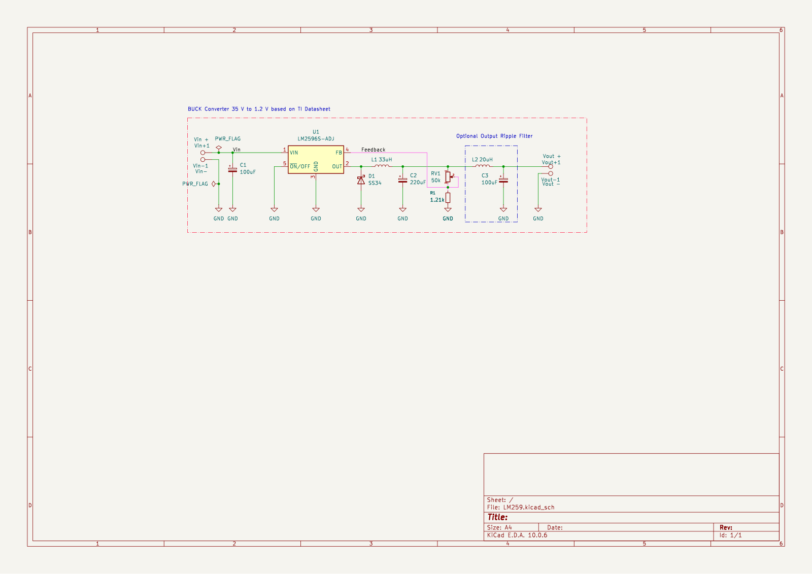
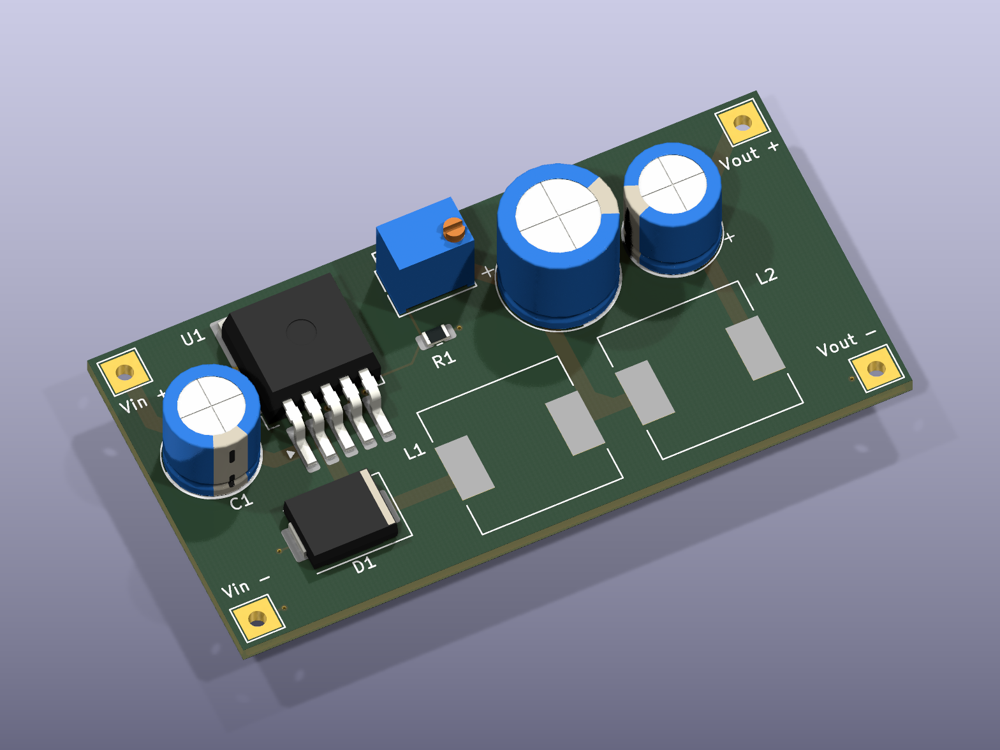
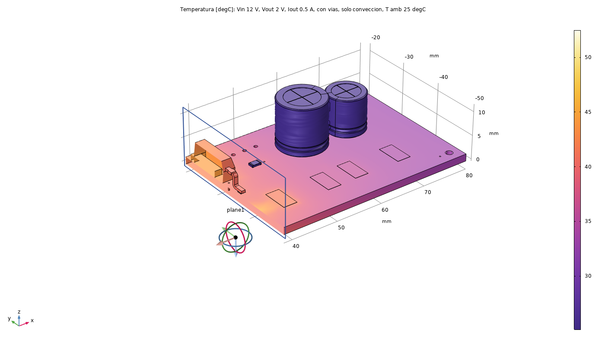

# Adjustable Buck Converter (LM2596)

Adjustable step-down (buck) power supply based on the LM2596S-ADJ, documented as an honest engineering
logbook: every result is marked as calculated, simulated, or pending — no invented placeholders. A quick,
deliberately simple project in the same series as
[LM317-Adjustable-PowerSupply](https://github.com/IKGB105/LM317-Adjustable-PowerSupply) (same thermal
analysis style, meant as a direct comparison point) — built mainly to get hands-on KiCad PCB layout
experience (placement, trace widths, a ground-plane strategy, via stitching) before moving on to
multiphase VRM work.

- **Input:** 12–40 V DC (datasheet reference design)
- **Adjustable output:** 1.23 V to ≈ 35 V (RV1 position-dependent, see report)
- **Demonstration condition used for thermal comparison:** 12 V → 2 V @ 0.5 A (same load as the LM317
  companion project)

> ⚠️ **Not safe across the full adjustable range.** At the low-output-voltage extreme (35 V → 1.23 V),
> the catch diode D1 exceeds its rated junction temperature above ≈1.5–2 A. This is a genuine finding
> from the COMSOL analysis, documented in Section 7 of the report — not a flaw hidden from this README.

<table>
<tr>
<td><br><sub>KiCad — schematic</sub></td>
<td><br><sub>KiCad — PCB 3D render</sub></td>
<td><br><sub>COMSOL — thermal result (12 V → 2 V, 0.5 A)</sub></td>
</tr>
</table>

## Thermal result (resolved for the demo condition, limitation found at the range's extreme)

- **At 12 V → 2 V, 0.5 A:** COMSOL gives **0.444 W** total estimated loss — **44.3 °C** on the LM2596's
  junction, **52.5 °C** peak on the catch diode (D1). Both comfortably under their rated limits, and a
  large improvement over the LM317 companion project's result at the same load (5.37 W, ≈144 °C with a
  heatsink).
- **Root cause of the D1 limitation above:** a single isolated ground via at D1's anode pad. A fix (more
  copper/vias there) is proposed but **not implemented** in this revision — see the report.

## Repository structure

```
docs/         LaTeX report (lm2596_buck.tex) + figures
LM259/        KiCad project — schematic + PCB, ERC/DRC clean
fem/          COMSOL thermal FEM: exported STEP geometry, result CSVs, figures, model-generation scripts
```

## Document

The full report (reference design, KiCad layout decisions, COMSOL thermal methodology, both operating
points, the D1 root-cause finding, the full modeling/debugging log, limitations) is in
[`docs/lm2596_buck.pdf`](docs/lm2596_buck.pdf) — compiled and committed. Source is
[`docs/lm2596_buck.tex`](docs/lm2596_buck.tex) if you want to edit or recompile it yourself
(`pdflatex`, or [Overleaf](https://www.overleaf.com/)).

## Design (no SPICE simulation — by design)

Topology and component values are taken directly from the LM2596 datasheet's own validated application
circuit (Figure 30, "1.2 to 35 V Adjustable 3.0 A Power Supply"), not re-derived in LTspice — re-simulating
an already-validated manufacturer reference would not have added information, so the time went into the
PCB layout and thermal validation instead, which *are* specific to this board. Full component list and the
output-voltage equation are in the report.

## PCB (KiCad)

In [`LM259/`](LM259/) — ERC and DRC both clean. Two-layer board (not four, unlike the VRM project — a
single ground domain and 3 A don't justify the extra layers). Notable layout decisions, documented in
full in the report:

- Feedback divider (RV1/R1) kept physically separated from L1, following the datasheet's own layout
  app note ("keep feedback wiring away from inductor flux") — deliberately *not* copying a real commercial
  LM2596 module's layout, which places the trimmer right next to the inductor.
- Power traces sized to ≈1.3 mm (IPC-2221, 3 A, conservative 10 °C rise) — correcting an early "as narrow
  as possible" instinct that would have been wrong for the current-carrying nets.
- Bottom-layer solid ground pour, stitched with vias (not via-in-pad, to avoid a solder-wicking risk);
  U1's exposed thermal pad gets 9 vias in a 3×3 grid.

## Thermal FEM (COMSOL)

In [`fem/`](fem/) — *Heat Transfer in Solids*, natural convection, 25 °C ambient, no heatsink. PCB geometry
exported from the KiCad design to STEP; heat sources are **datasheet-derived analytical loss estimates**
(Vsat/Vf scaled from their 3 A datasheet values, assumed 100 ns switching transition) — not measured or
chip-vendor-simulated. Two operating points were solved:

1. **12 V → 2 V, 0.5 A** (demonstration/comparison point) — [`fem/resultados/caso_12V_2V_05A.csv`](fem/resultados/caso_12V_2V_05A.csv)
2. **35 V → 1.23 V, swept 0.5–3 A** (worst case, minimum duty cycle) — [`fem/resultados/barrido_corriente.csv`](fem/resultados/barrido_corriente.csv), with via/radiation/L-loss variants in [`fem/resultados/variantes.csv`](fem/resultados/variantes.csv)

**The worst-case sweep found the catch diode (D1), not the LM2596, is the real thermal limit** — it
exceeds its rated junction temperature above ≈1.5–2 A at this extreme Vin/Vout ratio, even though the
regulator IC itself stays within limits through the full 3 A sweep. See the report for the root-cause
analysis (an isolated ground via at D1's anode) and the proposed, not-yet-implemented fix.

## License

MIT — see [LICENSE](LICENSE).
